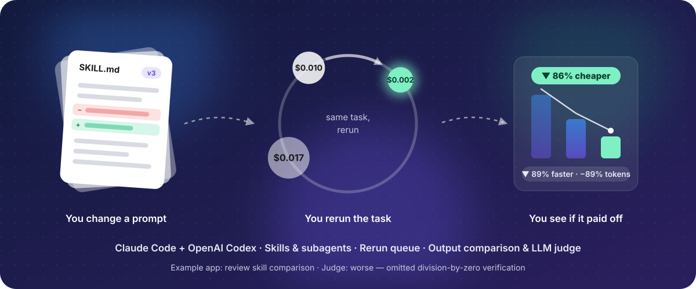
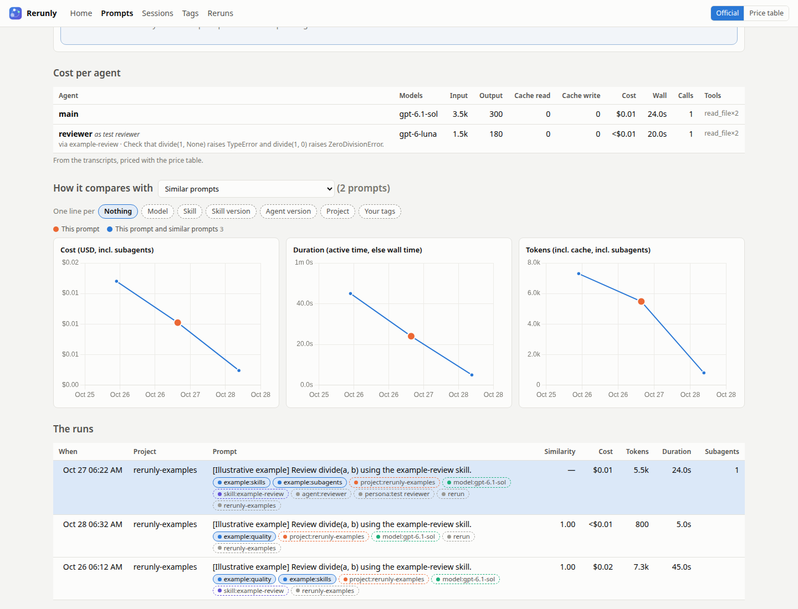
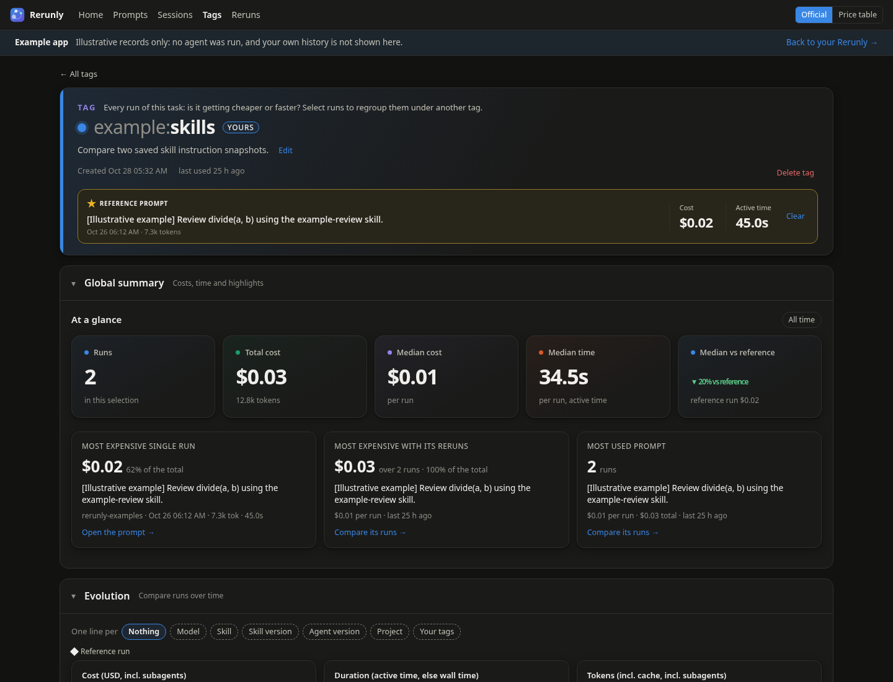
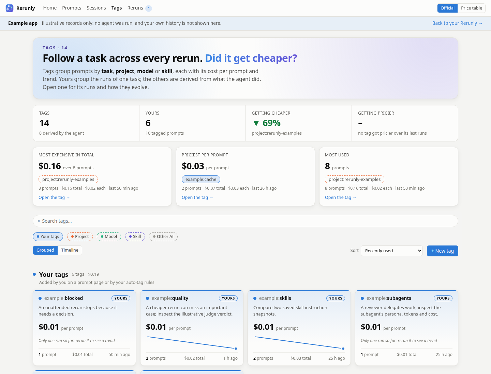

<p align="center">
  
</p>

<p align="center">
  <picture>
    <source media="(prefers-color-scheme: dark)" srcset="docs/logo-dark.svg">
    
  </picture>
</p>

<p align="center">
  <b>Cost, tokens and time for every prompt you give Claude Code,<br>so each rerun tells you if your last change made it cheaper, faster, or neither.</b>
</p>

<p align="center">
  
  
  
  
  
</p>

---

You tweak a skill, rewrite a `CLAUDE.md`, add a subagent… and then? Did the task get
**cheaper**? **Faster**? Or did that clever persona just double your token bill?

**Rerunly** reads the transcripts Claude Code already writes on your machine and turns them
into a living cost history: **per prompt, per subagent, per persona, per task**. Every rerun of
a task lands next to the previous ones, so after each change you see, at a glance, whether it
paid off.

## ✨ Why you'll love it

<table>
<tr>
<td width="50%" valign="top">

### 💸 Know the real cost
Dollars, tokens and time for every prompt, **including every subagent** it spawned. Use
Claude Code's **own official cost** (via OpenTelemetry) or your price table, with a switch to
compare them.

</td>
<td width="50%" valign="top">

### 📈 See the trend, not just the bill
Every task gets a sparkline and a verdict: **▼ 46% cheaper** or **▲ 200% pricier** than its
previous runs. Similar prompts are lined up automatically, so you compare like with like.

</td>
</tr>
<tr>
<td valign="top">

### 🏷️ Tags that write themselves
Project, model, skill, slash command, subagent type and persona tags are **created
automatically**. Add your own (`task:review-branch`) once, give it keywords, and every
future prompt that matches is tagged for you.

</td>
<td valign="top">

### 🔍 Find the expensive habits
Order your tags by **most used**, **priciest per run** or **most time in total**. Spot the
persona that burns tokens, the skill that drags, the project that quietly costs the most.

</td>
</tr>
<tr>
<td valign="top">

### ⚡ Always on, never in the way
Runs in the background with an **icon in your status bar** showing today's spend. Starts at
login on its own. Updates live after every Claude answer through a hook.

</td>
<td valign="top">

### 🔒 Yours, and only yours
No account, no cloud, no upload. A local SQLite file and a local web page. Your prompts
never leave your machine.

</td>
</tr>
</table>

## 🚀 Up and running in 60 seconds

```bash
git clone git@github.com:goldener-data/rerunly.git && cd rerunly
uv sync
uv run rerunly start   # runs in the background, with a status bar icon
```

Open <http://127.0.0.1:8765>, go to **Setup**, and press:

1. **Import now**: your whole Claude Code history appears.
2. **Install hook**: new prompts show up the moment Claude answers.
3. **Enable telemetry** *(optional)*: switch to Claude Code's own cost figures.
4. **Start at login** *(optional)*: never think about it again.

That's it. Go do some work, then come back and see what it cost.

## 🖼️ A tour

<table>
<tr>
<td width="50%" valign="top">

<p><b>Prompts, by tag</b>: one card per task, with its median cost, trend and latest run, in
sections per tag family. Order them by most used or priciest per run, or switch to a plain list
by day. Filter by project, tag or period, and share any view by URL.</p>
</td>
<td width="50%" valign="top">

<p><b>A prompt, dissected</b>: the main agent and every subagent side by side (models, cache
reads and writes, cost, tools), and charts of how this task's cost, time and tokens evolved
across all its runs.</p>
</td>
</tr>
<tr>
<td valign="top">

<p><b>A tag's story</b>: runs, total and median cost with its trend, the keyword rules that
assign it, and its full history. Dark mode included, of course.</p>
</td>
<td valign="top">

<p><b>The Tags gallery</b>: every tag as a card, clustered by type and family, or laid out on
a timeline by creation date. Click one to open its charts in place.</p>
</td>
</tr>
</table>

## 🧭 What's inside

<details>
<summary><b>Prompts page</b>: list or by tag, with filters you can share</summary>

- A summary band that follows your filters: prompts, total cost, cost per prompt, agent time.
- A toolbar that stays visible while you scroll: search, **Project** and **Tag** pill menus
  (searchable, grouped by category), period (today, 7 days, 30 days, all time) and sort
  (newest, most expensive, longest, most tokens). Click a tag on any prompt to filter by it.
  Active filters show as removable chips and live in the URL, so any view can be bookmarked.
- **List** layout: prompts grouped by day with each day's total; each row shows its cost with a
  bar relative to the most expensive prompt shown, plus tokens, time and subagents.
- **By tag** layout: one foldable section per tag family (the prefix before `:`, such as
  `task:`, `project:`, `model:`, `skill:`, `cmd:`, `agent:`), with jump links at the top. Each
  tag is a card with its median cost per run, trend, sparkline, totals and latest run. A section
  shows one row of cards (as many as fit), "Show N more tags" reveals the rest, and "Show N
  more runs" lists a tag's earlier runs. An **Order** menu sorts the cards in two sections:
  *Tags* (most used, recently used, newest tags, A to Z) and *Timing, cost & usage* (priciest
  per run, most expensive in total, longest per run, most time in total, most tokens per run).
  Prompts without any of your tags get their own "Not tagged by you" card.
</details>

<details>
<summary><b>Prompt page</b>: every agent, every token, and how it evolves</summary>

- Total cost, tokens, active time and wall time; cost, tokens and active time are compared
  with the comparison group's median (for example "-23% vs group median").
- A per-agent table splitting the main agent from each subagent: models, input, output, cache
  read and cache write tokens, cost, duration, tool calls. Each subagent shows its **persona**
  and the skill that spawned it; runs of one agent type with different personas are reported
  apart.
- Cost, duration and token charts over the prompt's history: its similar prompts (default), all
  prompts sharing one of your tags, or similar prompts sharing it, split by model, skill,
  project or your tags if you like (see [How prompts are linked](#-how-prompts-are-linked)).
- *+ Add a tag*: one of your tags, or a new one with a description and rules.
- **Run it again**: what ran the prompt (the agent and its version, the model and effort, and
  each skill's exact version) and a command repeating it: same folder, skills checked out at the
  commit they ran from, same agent release and model. View or download each skill exactly as it
  ran, even when no commit has it.
- **Rerun with Claude**: the same folder and prompt, with **the skills as they ran** (rebuilt
  from their commit, or their snapshot, into a plugin for that run only: your copies stay
  untouched), the same model and effort or others, the installed Claude Code or a given release.
  **Unattended** (the default), it runs in the background: anything that would need you (a
  command, an edit, a question) is denied, the agent stops and says what it needed, and a budget
  cap stops runaways. **In a terminal**, you watch it and approve its actions.
- Each rerun gets a **status**: running, done, needs you (with the actions it was denied and
  what it said it needed), or failed.
- **Compared with the original**: a rerun's page sets its figures (cost, tokens, time, calls)
  next to the original's, lists the files each edited, and shows both final answers side by
  side or as differences.
- **LLM judge**: once a rerun is imported, an LLM rates how close its output is to the
  original's in substance (0–100, wording aside), whether it is better, the same or worse, and
  whether you should read it: **✓ Good enough**, **◐ Minor differences** or **⚠ Look at it**,
  with a one-line summary and the main differences. The badge shows wherever reruns are listed.
  Pick the judge model per rerun or per comparison; the default (haiku) is set on the Setup
  page. The judge runs in an empty scratch folder, saves no session and has a budget cap.
- **Compare**: any two runs of a prompt (the original, its reruns, its tags' reference runs)
  side by side, with the judge's call and a button to judge them with the model of your choice.
- **Reruns are studied on their own**: every prompt of a rerun gets the `rerun` tag (filter on
  it, or leave reruns out of the history on the Setup page) and none of the original's tags. A
  rerun's page says what it reruns, its cost against it, and the configuration chosen to launch
  it (model, effort, Claude Code release).
- When one of the prompt's tags has a reference run, *Settings from* reuses the reference's
  model, effort and Claude Code release; on a tag's page, *Queue … with the reference's
  settings* does it for many prompts at once.
- **Add to queue** keeps a rerun for later, with the settings picked. Queue many at once from
  the Prompts page or a tag's page: *Select prompts*, then *Queue reruns*.
</details>

<details>
<summary><b>Tags</b>: five color-coded categories, automatic and your own</summary>

- **Your tags** (blue, filled chip): added by hand, to a selection of prompts, or by rules.
  Use them to group prompts aiming at the same task, such as `task:review-branch`.
- **AI tags** (dashed outline), derived from what the agent did and refreshed on every import:
  **Project** (orange) `project:`, **Model** (aqua) `model:`, **Skill** (violet) `skill:`,
  and **Other AI** (grey) `cmd:` for slash commands, `agent:` for subagent types, `persona:`.
- Color is never the only cue: chips carry their prefix and your tags' chips have their own shape.
  The palette passes a color-blindness check in light and dark mode.
- **New tag**: a name, a description and rules (keywords or a skill, in a prompt or in a
  session), each rule in its own color with a live count of matches.
- **Tags gallery**: cards with cost per prompt, sparkline and trend badge; a summary band with
  the priciest and most used tags; search, category filters, five sorts; **Grouped** (by
  category, then family) or **Timeline** (by month of creation) layouts. Click a card to open
  its charts in place; Escape closes them.
- **A page per tag**: a header in the tag's color, its rules as colored chips you can change or
  remove, a summary band (runs, total cost, median cost with trend, median time), charts with
  one line per model (or skill, project, tag of yours), and its runs with the Prompts page's
  toolbar.
</details>

<details>
<summary><b>Reruns</b>: a queue, launched together</summary>

- The queued reruns, with their prompt, its original cost and the settings to rerun it with
  (model, effort, Claude Code release). Pick some, or all, and **Run selected**: each opens its
  own Claude Code window, all at the same time, after a confirmation saying how many and what
  their originals cost.
- **Launched**: every rerun started from the dashboard, and once imported, its cost and time
  against the original.
</details>

<details>
<summary><b>Sessions, Setup and the status bar icon</b></summary>

- **Sessions**: every session with its totals, and a page each with the price-table cost next
  to the total Claude Code stores, tokens, active time, API and tool calls, cost per agent type
  and persona, Claude Code's own per-caller cost when telemetry is on, and its prompts over
  time.
- **Setup**: check that transcripts are found, install the live-update hook, enable telemetry,
  extend transcript retention, start at login, leave projects, skills, subagent types or
  sessions out of the history, and edit the price table and similarity threshold. Tags and
  their rules live on the Tags pages.
- **Status bar icon**: today's cost and prompt count, *Open dashboard* (also a left click),
  *Import now*, *Start at login* and *Quit*.
</details>

## ⚙️ Running it your way

```bash
uv run rerunly                # in the foreground, http://127.0.0.1:8765
uv run rerunly start          # in the background, with a status bar icon
uv run rerunly stop
uv run rerunly autostart on   # start at every login, without any action (off to undo)
uv run rerunly ingest         # import once and exit (--force to re-parse everything)
uv run rerunly --reload       # while hacking on it: restarts on Python changes
```

- **Start at login** writes a standard desktop entry to `~/.config/autostart`, run by GNOME,
  KDE and other desktops. You can also switch it from the icon's menu or the Setup page.
- The icon uses Qt (PySide6, installed by `uv sync`) and your desktop's StatusNotifier tray.
  On Ubuntu GNOME it shows through the AppIndicator extension Ubuntu enables by default. With
  no tray, the dashboard still runs in the background. Its log is in
  `~/.local/share/rerunly/tray.log`.
- If a dashboard already serves the port (say, one started with `--reload`), the icon reuses
  it instead of starting a second server.
- Page files are never cached and `--reload` restarts the server on code changes, so a page
  refresh always shows the latest version.
- The database lives in `~/.local/share/rerunly/dashboard.db`. Change it with `--db` or
  `RERUNLY_DB`. Coming from the tool's former name, Agent Task Dashboard? Your data moves
  over by itself the first time you run `rerunly`.

## 🔗 How prompts are linked

A prompt is only interesting next to its other runs. Rerunly links prompts in three ways, from
the most automatic to the most deliberate.

**1. Sessions: where it was typed.** Every prompt belongs to the session (the conversation) it
was typed in. Everything the agent did until your next prompt belongs to it, subagents included:
they are tied to their prompt through the transcript's `promptId`. When a session is resumed or
forked and replays earlier prompts, each prompt stays in its first session, so nothing counts
twice.

**2. Similar prompts: what it says.** Two prompts are similar when their words overlap enough.
Each text is lowercased and split into words; one-letter words and common ones (*the*, *and*,
*please*…) are dropped. The score is the share of words they have in common (Jaccard: shared
words ÷ all distinct words), and prompts scoring at least the **similarity threshold** (0.6 by
default, on the Setup page) are similar. Running the same slash command counts as at least 0.5,
plus half the word overlap: with the default threshold, `/review` runs are similar as soon as a
fifth of their words match. A prompt rerun word for word is similar to its earlier runs, unless
it is only common words (such as "do it"), which leaves nothing to compare.

**3. Tags: what you decide.** Prompts sharing a tag are linked, whatever their words.

- **AI tags** come from what the agent did, refreshed on every import: the project
  (`project:`), the models that answered (`model:`), skills used (`skill:`), the slash command
  (`cmd:`), subagent types (`agent:`) and their personas (`persona:`).
- **Your tags** link the runs of one task, such as `task:review-branch`. Give one:
  - **by hand**, on a prompt's page (*+ Add a tag*);
  - **to many prompts at once**: on the Prompts page (List view) or a tag's page, *Select
    prompts*, search or filter, *Select all*, then *Tag N selected…*;
  - **with rules**, which tag past prompts right away and new ones on every import. A rule is a
    keyword alone, several keywords that must all appear (*any of them* becomes one rule per
    keyword), or a **skill** the agent used. It applies **in a prompt** (that prompt gets the
    tag) or **in a session** (the session's title or any of its prompts matches, and every
    prompt of that session gets the tag). A prompt matching any of a tag's rules gets the tag.

  Deleting a tag only removes the tag and its rules: the prompts stay.

**Where the links are used**

- On a **prompt's page**, *How it compares with* picks the prompt's history: its **similar
  prompts** (default), **all prompts tagged** with one of your tags, or **similar prompts
  tagged** with it (when one tag covers several kinds of prompts). The charts, the
  "vs group median" figures and the table of runs all use that history and nothing else.
- *One line per* splits that history by **model**, **skill**, **skill version**, **agent
  version**, **project** or **your tags**, with a table of each group's runs, median cost, time
  and tokens, and the cheapest one marked. The same split works on every **tag's page**, over all
  its runs: the way to see which model, or which version of a skill, does a task for less.
- Any tag can have a **reference run**, the version the others are measured against: click ☆
  on one of its runs. Every run then shows its cost against it (*▼ 23% vs ref*), the charts mark
  it with a ◆, and a prompt compared with that tag shows its cost, tokens and time against it.

**Tip:** for the most reliable comparison, give a task's runs one tag of yours (a keyword rule
does it for you) and compare with "All prompts tagged …". Similarity is a good default, but it
only sees words.

## 🧮 How the numbers are computed

Trust, but verify: every figure comes from data Claude Code writes itself.

<details>
<summary>Show the details</summary>

| What | Source |
|---|---|
| Prompt | A user line in `<session>.jsonl` with `origin.kind == "human"` (typed text or a slash command). Everything until the next one, including background-task notifications, belongs to it. Local commands that never reach the model (`/plugin`, `/clear`) are dropped. |
| Tokens | `message.usage` of each assistant message, counted once per message id. Claude Code writes one line per content block, and each line repeats the usage. |
| Subagents | `<session>/subagents/agent-*.jsonl`, linked to their prompt through `promptId`. The type and description come from `agent-*.meta.json`. |
| Cost | **Claude Code's own cost** when telemetry is on and covers every API call of the prompt. Claude Code sends a `claude_code.api_request` OpenTelemetry event per API call, with `cost_usd` and a `prompt.id` equal to the transcript's `promptId`; the dashboard receives these events at `/v1/logs` (OTLP, `http/json`). These figures include internal calls the transcripts don't detail, such as WebSearch. **Otherwise**, the price-table estimate: token counts × the price table on the Setup page. Cache writes cost 1.25× the input price (5-minute TTL) or 2× (1-hour TTL), fast mode costs 2×, and web search costs $10 per 1,000 requests. Models missing from the table are flagged. Each prompt shows which source was used. |
| Active time | Sum of Claude Code's `turn_duration` events for the prompt. |
| Wall time | From the prompt to its last event, including subagents that finish later. |
| API time | Sum of `duration_ms` over the prompt's telemetry events (telemetry only). |
| Persona | Read from the start of the subagent's prompt: `<persona>…</persona>`, `Persona: …` / `Role: …`, or `You are a…` / `Act as…`. The skill is the last one invoked (or the slash command run) before the subagent was spawned. |
| Skill version | The instructions the agent loaded, which Claude Code writes into the transcript after a `Skill` call ("Base directory for this skill: …"): an exact snapshot, kept by its hash. Its origin is found once, at import: the newest git commit made before the run whose `SKILL.md` (without frontmatter) matches, the version in the nearest `.claude-plugin/plugin.json`, or the Claude Code release bundling it. |
| Agent version, model, effort | The `version`, `requestedModel` and `effort` fields of the transcript, plus the model of each answer. |
| Similar prompts | Word overlap (Jaccard) ≥ the threshold (default 0.6); the same slash command counts as 0.5 + half the overlap. See [How prompts are linked](#-how-prompts-are-linked). |

Switch between the two costs at any time with **Official / Price table** in the top bar:
**Official** shows Claude Code's own cost for every prompt telemetry fully covers and the
estimate for the rest; **Price table** always shows the estimate. Each prompt's cost shows the
other figure underneath.

As a sanity check, Claude Code stores a session-level `cost-state` total: price-table estimates
land within a few percent of it, and on a test prompt telemetry and the price table agreed
exactly. Telemetry only applies to Claude Code sessions started after it is enabled, and calls
made while the dashboard is not running are lost; a prompt missing some of its calls falls back
to the estimate.
</details>

## 🛣️ Beyond Claude Code

Claude Code is supported today. Parsing sits behind a small `Source` interface
(`rerunly/sources/base.py`), so other agents and harnesses can plug in next.

## 🛠️ Development

```bash
uv sync
uv run rerunly --reload   # edit, refresh the page, repeat
uv run pytest
```

<p align="center"><sub>Built for people who tune their agents like they tune their code.</sub></p>


### OpenAI Codex

Codex CLI and IDE rollout history is imported automatically from
`$CODEX_HOME/sessions` (or `~/.codex/sessions`). Change **Codex sessions directory**
on Setup if needed. Existing installations gain the new default model prices without
replacing edited prices. Refresh imports changed rollouts; the normal polling interval
also keeps them current. No API key is needed for importing history.

Codex prompts use the same history, filters, tags, comparisons, references, exclusions,
exports, rerun queue and output judging as Claude prompts. Imports include the recorded
model, CLI version, reasoning effort, prompt/answer, token/cache counts, tool calls,
`apply_patch` file paths, and explicitly injected `<skill>` snapshots. Parent spawn
outputs identifying child thread IDs link separate subagent rollouts to their prompt.
Both cumulative `token_count` and response-level `token_usage_record` formats are supported;
when both exist, only response-level usage is counted. Cached input is subtracted from
input before pricing; reasoning output is already included in output tokens.

Choose a `codex:` model in the rerun or judge picker to use Codex. The picker includes
the documented Codex models, account-visible entries from the local model cache, and
previously used OpenAI model IDs. Availability depends on the account and CLI release.
Codex must be installed and authenticated to run tasks; pinned releases use
`npx -y @openai/codex@VERSION`. Reruns start fresh in the original directory and retain
a small replay marker in their prompt so their imported history links to the original.
Restored skills are placed in an isolated folder and referenced by exact path in the
rerun's instructions. They are removed after a background run finishes.

Codex does have these parity limits:

- **No dollar budget cap:** Codex background reruns reject a USD budget rather than
  pretending to enforce one. They have a one-hour process timeout. Codex judging has
  a ten-minute timeout and no dollar cap.
- **Permissions differ:** read-only and workspace-write sandbox policies restrict
  filesystem access, but both allow sandboxed commands. Workspace-write is broader
  than Claude's edits-only permission. Background approval policy is `never`.
- **Estimated cost only:** standard short-context API prices estimate token cost;
  they are not subscription charges or credit consumption. Unknown models are flagged
  unpriced. Fast/long-context rates, cache writes, hosted tools and other billing
  adjustments are not fully represented by Codex rollout data and this estimate.
  Claude-specific cost telemetry and Stop-hook installation do not apply to Codex;
  Codex history uses automatic polling instead.
- **Transcript-dependent detail:** only recorded skill bodies can be restored;
  reading a skill through arbitrary shell commands does not reliably provide a
  recoverable skill snapshot. Skill-to-subagent association, personas and edited files
  cannot always be recovered. Only explicit spawn-result links are attributed;
  missing or unlinked child transcripts cannot provide complete subagent totals.
  Exact historical API request counts are unavailable in older cumulative-only logs.
  Active time is elapsed turn time where completion events exist, rather than
  Claude's harness-reported active duration. A replay does not restore conversation
  context, repository state, authentication, MCP servers or the full harness configuration.

Model and CLI behavior were checked against the
[official Codex model documentation](https://learn.chatgpt.com/docs/models),
[CLI reference](https://learn.chatgpt.com/docs/developer-commands?surface=cli), and
[OpenAI API pricing](https://developers.openai.com/api/docs/pricing).

### Automatic model prices

During import, Rerunly checks newly recorded models (including subagents), locally
listed Codex models, and the configured judge for missing exact prices. It fetches
public OpenAI or Claude pricing tables and saves standard short-context input,
output, and cached-input estimates. A new version is looked up separately even
when an older family prefix already supplies a fallback estimate. Dated snapshots
can share the published base model price.

Successful lookups cache the provider catalog for 24 hours; failures retry after
one hour without blocking imports. Newly found prices also recalculate existing
history for linked agents whose transcripts remain available. Manual price entries
and edited family prefixes take precedence. No prompts or session data are sent;
only the public pricing pages are requested, without API keys or an LLM call.

Setup shows lookup status, missing prices, and source links under **Automatic model
pricing**. Turn off **Find prices automatically** to keep pricing entirely local.
If a provider has not published a price or its page format changes, Rerunly keeps
existing estimates and reports the missing lookup rather than inventing a price.
These are API token estimates, not subscription charges; pricing for long contexts,
special service tiers, and hosted tools can differ.

### Explore with examples

**Setup → Examples → Add examples** loads eight illustrative records, all tagged
`rerunly-examples`. Open that tag to browse the set, or use the smaller tags:

- `example:prompt-tuning`: broad Claude request versus focused Codex prompt, with a reference and an illustrative equivalent-output verdict.
- `example:cache`: the same task with cold and warm input caches.
- `example:skills` and `example:subagents`: two skill snapshots and a delegated edge-case review, including persona and subagent cost.
- `example:quality`: a cheaper rerun that misses a test case and receives an illustrative worse verdict.
- `example:blocked`: an unattended rerun needing a release-version decision.

All tokens, timings, outputs and ratings in this set are illustrative; no agents
or LLM judges are run. They appear in totals while visible. Hide the set with
**Setup → Excluded from the history → Examples**, or delete it with **Remove
examples**. Adding the set again does not duplicate it. The CLI equivalents are
`uv run rerunly examples` and `uv run rerunly examples --remove`.
