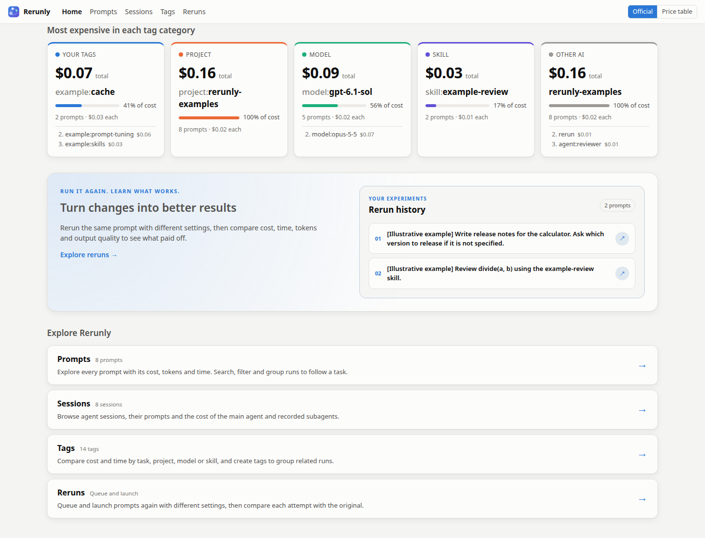
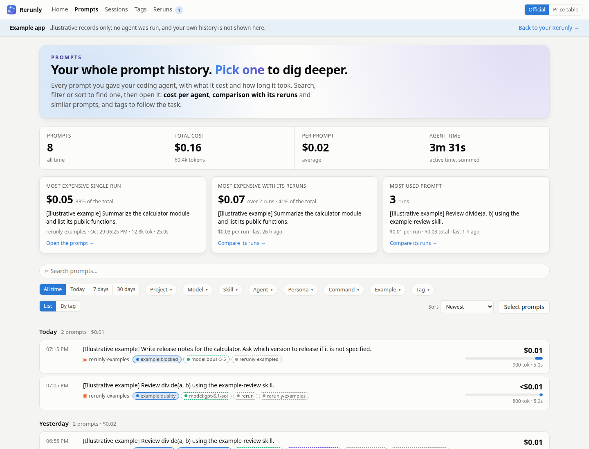
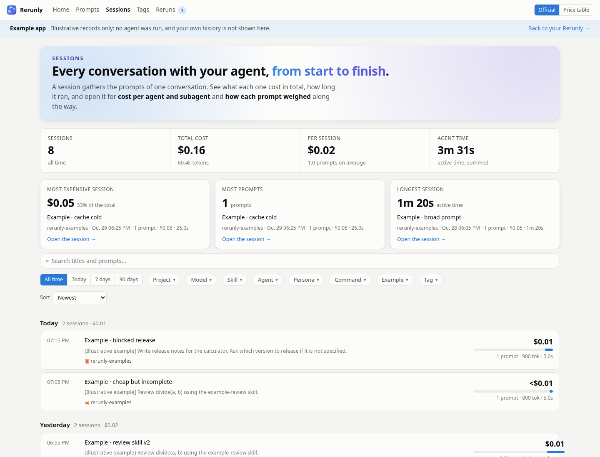
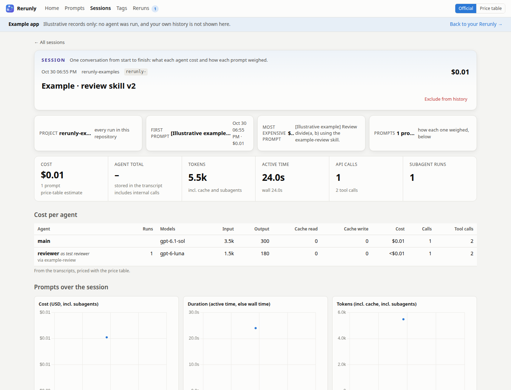
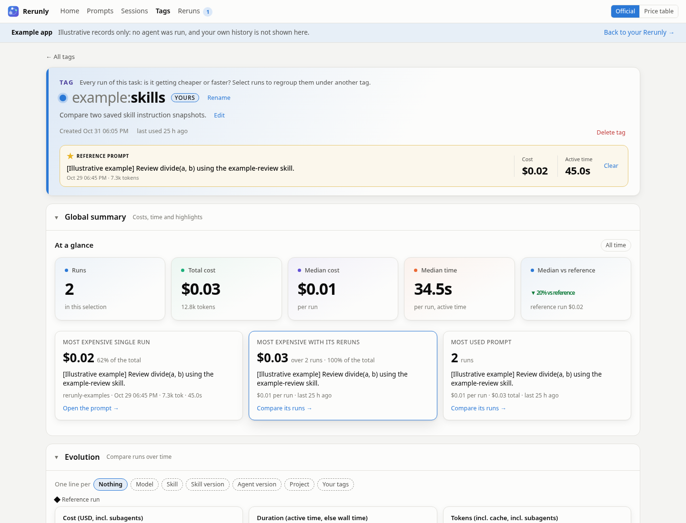
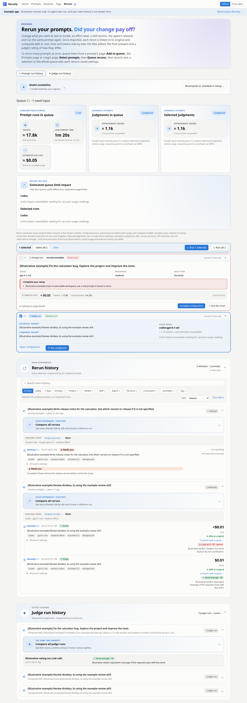
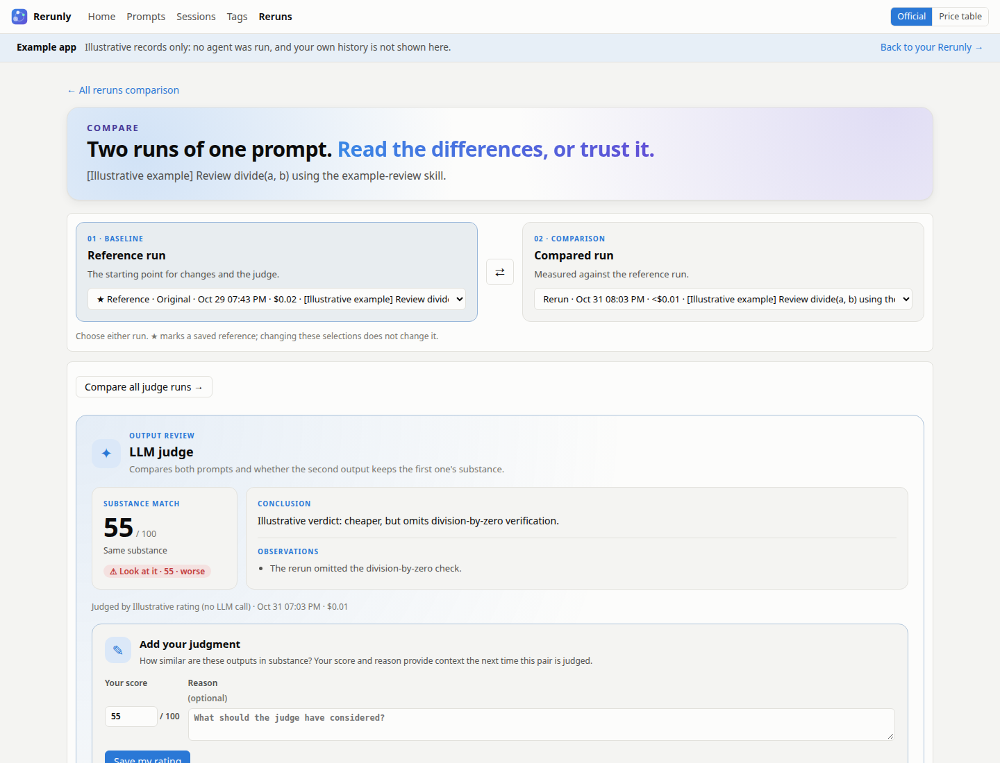

<p align="center">
  
</p>

<p align="center">
  <picture>
    <source media="(prefers-color-scheme: dark)" srcset="docs/logo-dark.svg">
    
  </picture>
</p>

<p align="center">
  <b>Cost, tokens and time for every prompt you give your coding agents,<br>so each rerun tells you if your last change made it cheaper, faster, or neither.</b>
</p>

<p align="center">
  
  
  
  
  
</p>

---

You tweak a skill, rewrite your agent instructions, add a subagent… and then? Did the task get
**cheaper**? **Faster**? Or did that clever persona just double your token bill?

**Rerunly** reads the transcripts your supported agents already write on your machine and turns them
into a living cost history: **per prompt, per subagent, per persona, per task**. Every rerun of
a task lands next to the previous ones, so after each change you see, at a glance, whether it
paid off.

## ✨ Why you'll love it

<table>
<tr>
<td width="50%" valign="top">

### 💸 Know what each task costs
Bring **Claude Code and Codex** into one history. See dollars, tokens and time for every
prompt, including linked subagents where recorded, using API price estimates or supported
agent-reported costs. Check reported account usage and reset times alongside your history.

</td>
<td width="50%" valign="top">

### 🔁 Rerun it. Change the settings. Measure the difference.
Launch a recorded task with a different **agent, model, effort or CLI release**, restoring
captured skills where available. Run it in a terminal or in the background, or queue a whole
selection. Review estimated cost, tokens and time before launching.

</td>
</tr>
<tr>
<td valign="top">

### ⚖️ Check that cheaper still does the job
Compare the original and rerun's **cost, edited files and final answers** side by side.
An LLM judge highlights substantive differences and flags **Good enough**, **Minor differences**
or **Look at it**, so you know where to focus your review.

</td>
<td valign="top">

### 📈 See whether your changes pay off
Follow cost, time and tokens across repeated tasks with charts and trend badges. Similar
prompts line up automatically; pick a **reference run** for a tag to compare against your
baseline and reuse its settings for the next batch.

</td>
</tr>
<tr>
<td valign="top">

### 🏷️ Keep useful comparisons together
Project, model, skill, command, subagent and persona tags appear automatically where recorded.
Add your own task tags, automate them with **include/exclude rules**, and curate out irrelevant
runs without deleting history. Your comparison groups stay under your control.

</td>
<td valign="top">

### 🔍 Find the expensive habits
Rank tags by **most used**, **priciest per run** or **most time in total**. Trace a costly task
through its session, agents, cache usage and recorded skill versions to see where the spend
comes from—and what to try changing next.

</td>
</tr>
<tr>
<td valign="top">

### ⚡ Always on, never in the way
Runs in the background with an **icon in your status bar** showing today's spend. Enable
start at login and let new history import automatically. Missing model prices can be looked
up automatically from official provider pages, with your overrides taking precedence.

</td>
<td valign="top">

### 🔒 Your history stays local
**No Rerunly account or cloud upload.** Imported history lives in a local SQLite file and a
local dashboard. Reruns, optional model checks and LLM judging use your installed, authenticated agents; automatic
price lookups send no prompts and can be disabled. [Account usage checks](#account-usage-and-reset-limits)
can contact providers using your agents’ existing logins.

</td>
</tr>
</table>

## 🚀 Getting started

Requires **Python 3.11+**, **uv** and **Git**. The status bar icon and start-at-login
integration target Linux desktops; the foreground web dashboard can run without the tray.

```bash
git clone https://github.com/goldener-data/rerunly.git
cd rerunly
uv sync
uv run rerunly start   # runs in the background, with a status bar icon
```

Open <http://127.0.0.1:8765> and go to **Setup**:

1. Under **Agents**, open **Details** for each linked agent to check its **Transcript directory**.
   Use **Save path** to change it, or **Remove** / **Add agent** to manage connections.
2. **Import now**: load your available history from supported agents.
3. **Start at login** *(optional)*: keep the dashboard running automatically.

For a foreground dashboard without the tray, use `uv run rerunly`. History import needs
no installed agent or API key when transcript files are already available. Running tasks or
judges requires an installed, authenticated Claude Code or Codex CLI; selecting a pinned
CLI release also requires Node.js and `npx`.

New history is imported automatically. For integration-specific setup, including hooks
and reported costs, see [Supported agents](#-supported-agents).

That's it. Go do some work, then come back and see what it cost.

## 🖼️ A tour

<table>
<tr>
<td width="50%" valign="top">
<a href="docs/screenshots/home.png"></a>
<p><b>Home at a glance</b>: Total spend, tokens and agent time, plus the most expensive and most repeated prompts. Category highlights help you find where the work goes, and rerun history links each original prompt to its comparisons.</p>
</td>
<td width="50%" valign="top">
<a href="docs/screenshots/prompts.png"></a>
<p><b>Every prompt in one history</b>: Search and filter by project, tag or period; sort by cost, tokens or time. Select prompts to tag them or queue reruns, and bookmark filtered views.</p>
</td>
</tr>
<tr>
<td width="50%" valign="top">
<a href="docs/screenshots/by-tag.png"></a>
<p><b>Tasks and trends</b>: Group prompts by tag family to compare median cost, sparklines and recent runs. Order cards by usage, cost or time to spot expensive habits.</p>
</td>
<td width="50%" valign="top">
<a href="docs/screenshots/sessions.png"></a>
<p><b>Whole conversations</b>: Browse sessions across Claude Code and OpenAI Codex, with search, tag filters and totals. Open a conversation to follow its prompts in order.</p>
</td>
</tr>
<tr>
<td width="50%" valign="top">
<a href="docs/screenshots/prompt.png"></a>
<p><b>Every agent and token</b>: See main-agent and subagent models, personas, skill attribution, cache usage, tools and costs. Expand the rerun panel to review current usage, choose settings and estimate usage impact.</p>
</td>
<td width="50%" valign="top">
<a href="docs/screenshots/session.png"></a>
<p><b>Inside a session</b>: Inspect the conversation’s totals, agent breakdown and prompt timeline, then open an individual prompt for its answer, skills and usage.</p>
</td>
</tr>
<tr>
<td width="50%" valign="top">
<a href="docs/screenshots/tag.png"></a>
<p><b>A tag’s story</b>: Set a reference run, track costs and curate the prompts belonging to a task. Keyword, skill and tag rules assign membership; exclusions keep irrelevant runs out.</p>
</td>
<td width="50%" valign="top">
<a href="docs/screenshots/tags.png"></a>
<p><b>The Tags gallery</b>: Browse automatic project, model, skill and agent tags alongside your own. Switch between cards and a creation timeline, and open a tag’s charts in place.</p>
</td>
</tr>
<tr>
<td width="50%" valign="top">
<a href="docs/screenshots/reruns.png"></a>
<p><b>Reruns and their status</b>: Queue runs with model, effort, release and permission choices, then launch them together. Review estimated tokens, concurrent time and API cost, complete missing queue configuration, and expand the history to explore attempts grouped by original prompt. Open **Compare all reruns** to select a reference run.</p>
</td>
<td width="50%" valign="top">
<a href="docs/screenshots/compare.png"></a>
<p><b>Savings and output quality</b>: Choose either run in the comparison, with saved references marked in the selectors. Compare cost, tokens, time, tool calls, edited files and final answers; use the review panel to choose a model and judge again. The LLM judge presents a substance score, conclusion and observations: this illustrative cheaper rerun misses a required check.</p>
</td>
</tr>
<tr>
<td width="50%" valign="top">
<a href="docs/screenshots/tag-dark.png"></a>
<p><b>Light and dark</b>: The dashboard follows your system theme. Tag prefixes and chip shapes distinguish categories alongside their colors in both modes.</p>
</td>
</tr>
</table>

Screenshots use the isolated example app: costs, timings, outputs and judge verdicts are
illustrative, not measured improvements. Always use the example app for documentation
illustrations. Click any image for the full-size view.

To refresh these images from the current UI, see [the screenshot capture script](docs/capture_screenshots.py).

## 🧭 What's inside

One local dashboard for **Claude Code and OpenAI Codex**: explore recorded work, group runs
by task, rerun them with different settings, and compare the cost and the output.
The detail available depends on what each agent records; see [Supported agents](#-supported-agents).

<details>
<summary><b>Home</b>: spending, repeated work and account usage at a glance</summary>

- Choose today, 7 days, 30 days or all time to see prompt and session counts, cost, tokens
  and agent time.
- Find the most expensive single run, the most expensive prompt across repeated runs, and
  the prompt you use most. Open the underlying runs to investigate.
- See the most used and most expensive tags across your tasks, projects, models and skills.
- Browse rerun history by original prompt and open its comparison of all attempts.
- Use the descriptive page links to explore prompts, sessions, tags, reruns and setup.
- Keep connected agents' reported usage windows, observation times and reset times in view
  across pages while scrolling with the floating usage panel. Drag its handle to move it,
  or close it and use **Show usage** to reopen it. You can also move it with the arrow keys
  while its handle is focused. These account limits are separate from API-price cost estimates.
</details>

<details>
<summary><b>Prompts</b>: searchable history, by day or by tag</summary>

- Search and combine filters by project, model, skill, agent, persona, command and custom
  tag prefixes (such as **Task** for `task:`). Select several values in each dropdown:
  any selected value within a category matches; all selected categories must match.
  **Tag** lists only tags without a prefix.
  The number beside each value is how many results selecting it would leave, given the search,
  period and selections in the other menus; values with none are dimmed.
  The period filter sits on the left. Use **Tag → rerun** to find reruns.
  In **By tag**, reruns appear under the automatic **rerun** tag.
  Search sits above the filters; layout, sorting and selection controls sit on the final row.
  Sessions, the Tags gallery and tag prompt lists use the same toolbar layout. Sort by newest, cost, duration or tokens.
  Sessions offer the same tag menus and keep conversations containing a prompt that matches
  all selected tags; their totals still include the whole conversation. There, the menu numbers
  count sessions; in **Rerun history**, attempts.
  Totals follow the filters, and filters live in the URL for bookmarking.
- **List** groups prompts by day, with daily totals and each run's cost, tokens, time and
  subagent count. Click a tag on a prompt to filter by it.
- **By tag** groups cards by tag family, with median cost, trend, sparkline, totals and the
  latest run. Expand a card for earlier runs; order tags by usage, recency, cost, time or tokens.
- Select prompts to tag them together or queue reruns in bulk. The selection action bar
  [Selection actions](docs/screenshots/prompt-selection.png) stay visible while you scroll
  through prompts, including on tag pages.
</details>

<details>
<summary><b>A prompt's page</b>: the request, answer and recorded usage</summary>

- Inspect this prompt's cost, tokens, active time and wall time.
- Read its final answer and break usage down by main agent and linked subagents:
  models, input/output and cache tokens, cost, duration and tool calls.
- Add tags and inspect recorded agent releases, permissions, effort and skill versions.
  View or download captured skill instructions.
- Expand **Rerun this prompt** for an explanation and current account usage, followed by
  agent and execution settings, then estimated additional usage and limit impact.
  Recorded configuration and skills have their own disclosure inside the panel.
  Hover, focus or tap a section’s ⓘ icon for an explanation; press Escape to dismiss it.
  See the [expanded rerun panel](docs/screenshots/prompt-rerun.png).
- Use tag pages and the Reruns page to compare runs and review results.
</details>

<details>
<summary><b>Tags</b>: task groups, reference runs and rules you can curate</summary>

- Automatic tags identify projects, models, skills, commands, subagent types and personas
  where recorded. Your own tags group work by purpose, such as `task:review-branch`.
- Browse the **Tags gallery** by category and family or on a creation timeline, with search,
  sorting, cost trends and charts that open in place.
- Each tag has its own history, summary and comparison charts. Set a **reference run** to
  measure other runs against it and reuse its model, effort and agent release for reruns.
- On a tag page, use **Rename** to change a tag you created. Its prompt assignments, rules,
  exclusions and reference run follow the new name; automatically derived tags keep their recorded names.
- Build rules with **Include keywords**, **Exclude keywords**, **Include tag** and
  **Exclude tag**, scoped to a prompt or session. Rules apply to existing and future history;
  exclusions take priority over inclusions.
- Curate your tags by excluding individual or selected prompts without deleting history.
  Review relevance warnings based on excluded examples, restore membership, or stop using an
  excluded prompt as an example. Similarity never excludes prompts automatically.
- See [Curate prompts within a tag](#curate-prompts-within-a-tag) for rule and restoration details.
</details>

<details>
<summary><b>Reruns</b>: choose a configuration, estimate usage and launch a queue</summary>

- From a prompt, use **Agent** to choose Claude Code or OpenAI Codex, then select a model,
  reasoning effort and CLI release, or copy a tag's
  reference settings. Launch immediately or **Add to queue**; queue selections from the
  Prompts page or a tag's page too.
- **Reruns → Model availability** summarizes whether model information is available; expand
  it for model counts and the time each agent was refreshed. **Recompute or schedule in Setup**
  opens **Setup → Model availability**, where all check controls live.
  See the [availability summary](docs/screenshots/model-availability-summary.png).
- In **Setup → Model availability**, choose agents and use **Check now**, or enable periodic
  checks every **6 hours**, **daily** or **weekly**, then **Save schedule**. Periodic checks
  are off by default and run only while Rerunly is running. Cancel an active check there.
  See the [model availability settings](docs/screenshots/model-checks.png).
- Each check refreshes the machine-readable catalog behind `/model` through your installed
  agents and deduplicates model aliases. **No test prompts are sent, and checks use no
  inference tokens or API credits.** Agents can contact their providers to retrieve model
  metadata. The example app never launches agents for these checks.
- **Listed by agent** means that the model appeared in the agent's catalog at the recorded
  time. It does not verify runtime access, subscription inclusion or remaining quota.
  Catalog failures are reported separately. Results are stored locally, apart from prompt
  history. Checks made by an older version may retain their previous test results until
  the next refresh.
- Rerun settings list models without model-access filters or verification badges.
  The separate judging controls offer **Model access** filters:
  **Subscription**, **API credits**, **Unverified** or **All models**. Subscription labels
  use Codex's recent signed-in model catalog. Claude's model menu can also list models
  requiring separate usage credits, so Claude subscription logins leave model inclusion
  **Unverified**; menu presence alone does not establish subscription inclusion.
  Historical models and unavailable metadata stay unverified. API labels
  mean the agent currently uses API billing. A model can support both login methods;
  filtering does not change your login or enable an unavailable model. Included usage
  limits and any enabled paid extra usage still apply. Account checks are cached for a minute;
  no model inference runs during discovery. The example app leaves access unverified.
- For terminal reruns, **After answer** chooses **Close terminal** (default) or
  **Keep open until Enter** to inspect the output before closing. This preference is saved
  with queued runs and can be changed in **Configure**. Rerunly exits the interactive agent
  after its transcript records turn completion; approval prompts remain available during the run.
- Reruns start fresh in the recorded working directory and restore captured skills where
  available. They do not restore the original conversation or repository state.
- **Same as original** reuses recorded permissions. Terminal mode lets you answer approval
  prompts; background mode needs compatible permissions or an explicit override. Missing
  directories or permission metadata require attention rather than guessed defaults. Changing
  agents requires an explicit permission choice; the original agent’s permissions cannot be reused.
  **Add to queue** can save an incomplete configuration, including unset permissions.
  The queue marks these runs **Needs input** in a highlighted warning within each run’s
  description, with a **Complete configuration** button. Use it to choose
  permissions, mode, budget or a missing working directory. The settings panel explains
  when explicit permissions are required in a highlighted warning and marks invalid fields.
  **Save settings** and **Save and continue** stay disabled while settings are incomplete,
  invalid, being checked or being saved. Validation preserves your edits.
  See the [settings warning example](docs/screenshots/queue-settings.png). **Configure** edits other runs too.
- The rerun form separates **Current account status** (reported usage and reset times) from
  **Rerun estimate** (additional tokens, API cost, duration baseline and learned limit impact).
  The prompt panel supports manual refresh and refreshes usage every minute.
- The **Reruns** navigation link shows a badge with the number of queued runs (hidden when
  empty). The **Reruns** page presents queued runs as cards with the agent, model, effort, execution
  mode, with a compact estimate row that includes the original cost. Expand **Settings & usage details** for
  permissions, release, working directory and usage forecasts. See the
  [queue card example](docs/screenshots/rerun-queue.png). Launch one,
  selected runs, or all together; review combined cost/tokens, summed run time and the
  longest-run duration baseline before launching. If any selected run needs input, launching
  opens its configuration form before any run starts. Save each incomplete configuration,
  then review the launch confirmation. Canceling keeps every run queued. Failed launches
  stay queued for retry.
- Queued runs warn when estimated cost exceeds a background Claude budget: the agent may
  stop before completing the task. Saved budgets are not enforced in terminal mode;
  the queue and launch confirmation warn that these runs can exceed them.
- Estimates reuse original usage at the selected model's prices, preserving recorded cache usage
  and unchanged subagent models. With the same model, the recorded cost is the baseline,
  preserving per-call cache-write rates and other recorded pricing details. Changed models
  are repriced from aggregate tokens, with cache writes using the standard 5-minute rate.
  A fresh rerun can reuse its cache between calls; actual usage and cache hits can differ. Unpriced models are flagged; displayed estimates can be partial.
  Actual usage can differ, and judge calls add usage.
  API estimates do not predict subscription charges. Separate empirical limit forecasts show
  an approximate percentage-point range and projected usage when calibration is available.
- **Rerun history** is an expandable section grouped by original prompt, with the latest
  attempts first. Search by prompt text, filter by period or tag categories (including project,
  model, skill and agent), and sort by recent, cost, duration or tokens. Filters match the
  original prompt or an imported rerun; a matching original keeps its entire group. Filter
  choices live in the URL for bookmarking, and sorting ranks groups by their highest matching
  rerun cost, duration or tokens.
  Expand a prompt group to see its original cost and settings, then each
  attempt's model, agent, effort, CLI release, status, cost and judge verdict. Follow
  **Attempt** for launch details, the prompt link for its imported output, or
  **Compare with original** for the comparison. **Compare all reruns** opens a table of every
  attempt alongside the original, including settings, status, cost, tokens, time and verdicts.
  The selected reference is highlighted above the charts, with its cost, tokens and time.
  Expand **Read the full original prompt** or **Full initial prompt** on a run to read its complete text.
  Charts show cost, duration and tokens over time for the original and imported reruns;
  a diamond marks the selected reference, and a point opens its prompt. Runs without imported
  usage remain in the table. The original is the initial reference; choose **Set as reference** on any imported run to
  save a new baseline for this prompt. Cost and time changes and judge verdicts then refer to
  that run. Choose a judge model and use **Judge output** or **Judge again** for each run;
  both runs need final answers. Each judge action shows a rough token estimate and any available
  account-limit forecast. Judge calls add usage and cost. Each imported attempt links
  to its detailed output comparison. Use **All reruns comparison** there to return to the
  original table, including when the comparison was opened directly from rerun history. The example app never runs judges. See the
  [all-reruns comparison example](docs/screenshots/rerun-comparison.png). Expand **All launch settings** for permissions,
  restored skills and other options. Expansion choices stay in place during page updates.
  Runs still in progress appear above the history.
- Follow launched runs as **running**, **done**, **needs you** or **failed**, then compare
  imported results with the original. Imported rerun prompts get the `rerun` tag and are
  studied separately from the original's tags.
  An attempt's link opens its rerun details, including the full error or result,
  launch settings and restored skills, even when no transcript was imported. **Check process
  and logs** refreshes the process state and shows the last 16 KB of a background log;
  terminal output stays in the terminal and agent transcript. Terminal reruns record completion;
  on Linux, older terminal runs with no matching process after two minutes are marked failed.
  When process inspection is unavailable their state remains unknown. From there,
  open the imported rerun when available, or use **Initial prompt →** to open the original.
  See the [rerun details example](docs/screenshots/rerun-detail.png).
- Permission modes, skill restoration, budget caps and timeouts vary by
  [agent](#-supported-agents).
</details>

<details>
<summary><b>Comparisons and LLM judging</b>: check whether savings kept the useful output</summary>

- Compare two runs side by side, including the original, reruns and tag reference runs.
  **Reference run** is the baseline and **Compared run** is measured against it. Swapping
  or changing these selections does not change the saved reference.
  Inspect both prompts, cost, tokens, time, tool calls, edited files and answer differences. The judge compares the selected pair, including changes to their requests.
- After a rerun is imported, an LLM judge compares its output with the original's substance:
  similarity from 0–100, better/same/worse/unclear, a short explanation and key differences.
- Verdicts flag **✓ Good enough**, **◐ Minor differences** or **⚠ Look at it** and appear
  wherever rated reruns are listed. They help direct review; they are not a test of correctness.
- From a two-run comparison, choose a judge model and **Add judgment to queue**. The
  shared Reruns queue labels **Judge run** and **Prompt run** separately; select, remove,
  or launch either type. Judge runs use the selected model (or the default at launch),
  and show a separate rough token estimate. The queue shows limit impact for the entire queue
  and the current selection, combining judgments and prompt runs by agent. Judgment cost and
  duration are unavailable; automatic judgments after prompt runs are extra. If the same pair is already
  being judged, another queued judgment stays in the queue until you launch it later.
  On Reruns, expand **Rerun history** for prompt attempts and **Judge run history** for separately requested judgments. Automatic judgments attached to reruns stay with those reruns. Older judgments whose origin was not recorded remain on their comparisons but are omitted from judge history. Expand a judge's prompt pair to see its runs and open their comparison. The history buttons jump to these sections.
- In **Reruns → Judge run history**, expand a prompt pair and choose **Compare all judge runs**. Its comparison page lets you select two judge runs to compare their scores, conclusions and observations side by side. It also summarizes the score range, average, verdict counts and your human score, then lists every completed judge run. Choose a model there to judge the pair again or add the judgment to the queue, with a usage estimate before launching. Earlier completed results are retained from this version onward. Open a pair to review it or add a human rating. See the [illustrative judge comparison](docs/screenshots/judge-comparison.png).
- On a judged comparison, use **Add your judgment** to save your own 0–100 substance score
  and an optional reason. The next AI judgment of those same prompts and answers receives
  your assessment as context. Existing scores and verdicts remain unchanged. Edit or remove
  your rating at any time; feedback is stored locally and tied to the compared inputs.
- Choose a judge model per rerun or comparison. Set the default model and its effort in
  **Setup** (initially `claude-haiku-5-5`, at the model’s default effort). An explicit model
  choice uses that model’s default effort. The comparison's judge panel estimates token usage
  from the two requests and answers and shows estimated limit impact when local calibration
  is available. It uses a rough input approximation and assumes 512 output tokens; actual
  usage, reasoning and CLI overhead can differ. Judging runs through an installed, authenticated
  agent in an empty scratch folder; it adds usage, with caps and timeouts depending on the agent.
- The judge receives both requests, final answers and edited file names, rather than file
  contents or a repository diff. Long text is truncated to 30,000 characters per field.
</details>

<details>
<summary><b>Sessions</b>: the conversation behind the prompts</summary>

- Search session titles and prompts, filter history, and open a session's full breakdown.
  Use **Tag → rerun** to find sessions launched as reruns.
- Inspect session totals, prompts over time, token usage, timing, tool calls and available
  per-agent detail. Agent-reported costs appear where supported.
- Exclude a session from dashboard history and restore it later from Setup.
</details>

<details>
<summary><b>Setup</b>: agent connections, model availability, imports and prices</summary>

- Add or remove agent connections, inspect imported history and connection status, and set
  transcript directories. Removing a connection keeps its imported history.
- Under **Model availability**, refresh agent model menus, choose the agents to check,
  schedule periodic refreshes and cancel active checks. These controls live only in Setup;
  Reruns shows the recorded information and refresh times.
- Import now, re-import all history, configure periodic imports and start at login.
  Claude Code also offers a Stop hook, cost telemetry, usage capture and retention settings.
- Leave projects, sessions, reruns or tags from any category out of history: your tags,
  models, skills, subagent types, personas, commands and other AI tags. Excluded prompts stay
  imported and return immediately when included again. Your tags and AI tags with the same
  name have separate exclusion controls. Adjust the similarity threshold used to link prompts.
- Edit model prices or let **Automatic model pricing** look up missing prices on official
  provider pages. Inspect lookup status, missing prices and source links; manual overrides
  take precedence. Price lookups send no prompts and can be disabled.
- Switch the top bar between **Official** (reported cost where fully covered, estimates
  otherwise) and **Price table** estimates. Neither measures subscription charges.
- Open a separate **example app** covering prompt tuning, caches, skills, subagents, quality
  tradeoffs and blocked reruns. Its illustrative records stay separate from your history,
  run no agents or judges, and reset when Rerunly starts.
</details>

<details>
<summary><b>Status bar icon</b>: keep the dashboard close</summary>

- See today's cost and prompt count; click to open the dashboard.
- Import history, toggle **Start at login**, or quit from the icon's menu.
- The background dashboard continues to work on desktops without a tray icon.
</details>

## ⚙️ Running it your way

```bash
uv run rerunly                # in the foreground, http://127.0.0.1:8765
uv run rerunly start          # in the background, with a status bar icon
uv run rerunly stop
uv run rerunly autostart on   # start at every login, without any action (off to undo)
uv run rerunly ingest         # import once and exit (--force to re-parse everything)
uv run rerunly --reload       # while hacking on it: restarts on Python changes
```

- **Start at login** writes a standard desktop entry to `~/.config/autostart`, run by GNOME,
  KDE and other desktops. You can also switch it from the icon's menu or the Setup page.
- The icon uses Qt (PySide6, installed by `uv sync`) and your desktop's StatusNotifier tray.
  On Ubuntu GNOME it shows through the AppIndicator extension Ubuntu enables by default. With
  no tray, the dashboard still runs in the background. Its log is in
  `~/.local/share/rerunly/tray.log`.
- If a dashboard already serves the port (say, one started with `--reload`), the icon reuses
  it instead of starting a second server.
- Page files are never cached and `--reload` restarts the server on code changes, so a page
  refresh always shows the latest version.
- The database lives in `~/.local/share/rerunly/dashboard.db`. Change it with `--db` or
  `RERUNLY_DB`. Coming from the tool's former name, Agent Task Dashboard? Your data moves
  over by itself the first time you run `rerunly`.

## 🔗 How prompts are linked

A prompt is only interesting next to its other runs. Rerunly links prompts in three ways, from
the most automatic to the most deliberate.

**1. Sessions: where it was typed.** Every prompt belongs to the session (the conversation) it
was typed in. Everything the agent did until your next prompt belongs to it, subagents included:
they are linked using the parent/child identifiers recorded by each agent. When a session is resumed or
forked and replays earlier prompts, each prompt stays in its first session, so nothing counts
twice.

**2. Similar prompts: what it says.** Two prompts are similar when their words overlap enough.
Each text is lowercased and split into words; one-letter words and common ones (*the*, *and*,
*please*…) are dropped. The score is the share of words they have in common (Jaccard: shared
words ÷ all distinct words), and prompts scoring at least the **similarity threshold** (0.6 by
default, on the Setup page) are similar. Running the same slash command counts as at least 0.5,
plus half the word overlap: with the default threshold, `/review` runs are similar as soon as a
fifth of their words match. A prompt rerun word for word is similar to its earlier runs, unless
it is only common words (such as "do it"), which leaves nothing to compare.

**3. Tags: what you decide.** Prompts sharing a tag are linked, whatever their words.

- **AI tags** come from what the agent did, refreshed on every import: the project
  (`project:`), the models that answered (`model:`), skills used (`skill:`), the slash command
  (`cmd:`), subagent types (`agent:`) and their personas (`persona:`).
- **Your tags** link the runs of one task, such as `task:review-branch`. Give one:
  - **by hand**, on a prompt's page (*+ Add a tag*);
  - **to many prompts at once**: on the Prompts page (List view) or a tag's page, *Select
    prompts*, search or filter, *Select all*, then *Tag N selected…*;
  - **with rules**, which tag past prompts right away and new ones on every import. A rule is a
    keyword alone, several keywords that must all appear (*any of them* becomes one rule per
    keyword), a **skill** the agent used, or another **tag** to include or exclude. Keyword
    rules can exclude matches too. A rule applies **in a prompt** (that prompt matches) or
    **in a session** (a matching title, prompt or tag affects every prompt in the session).
    Inclusion rules add eligible prompts; exclusion rules, explicit exclusions and tag
    priorities can keep them out. See [Curate prompts within a tag](#curate-prompts-within-a-tag).

  Deleting a tag only removes the tag and its rules: the prompts stay.

**Where the links are used**

- On a **tag's page**, compare cost, time and tokens across the prompts in that group.
  *One line per* splits charts by model, skill, skill version, agent version, project or tags.
- Any tag can have a **reference run**: click ☆ on one of its runs. The tag's charts mark
  it with a ◆ and its run list shows cost against the reference (*▼ 23% vs ref*).
- The **Reruns** page links completed reruns to side-by-side usage and output comparisons.

**Tip:** give a task's runs one tag of yours to keep useful comparisons together.

## 🧮 How the numbers are computed

Rerunly groups recorded usage by prompt and its linked subagents, then applies the configured
model prices. The longest matching model-ID prefix wins. Models without a matching price
are flagged as unpriced and contribute no estimated dollars, so totals can be incomplete. Reported costs, timing precision,
cache detail and subagent attribution vary by integration; see [Supported agents](#-supported-agents).
API price estimates measure token usage, not subscription charges or credit consumption.

Wall time runs from a prompt to its last recorded event. Similar prompts use word overlap
(Jaccard) at the configured threshold, as described in [How prompts are linked](#-how-prompts-are-linked).
Skill snapshots, agent versions, model and effort are captured where the transcript supplies them.

## 🤖 Supported agents

Rerunly currently supports **Claude Code** and **OpenAI Codex**. Both feed the same
local dashboard: prompt history, filters, tags, comparisons, reference runs, exclusions,
rerun queue and output judging. Available detail depends on what each agent records.

| Integration | History location | Updates | Cost source |
|---|---|---|---|
| Claude Code | `~/.claude/projects` | Polling; optional Stop hook for immediate updates | API price estimates; reported cost through optional OpenTelemetry |
| OpenAI Codex CLI and IDE | `$CODEX_HOME/sessions`, or `~/.codex/sessions` | Polling | API price estimates |

Both integrations are linked by default. On **Setup → Agents**, open **Details** to change
a transcript directory, **Remove** to stop future imports, or **Add agent** to reconnect.
Removing a connection keeps its imported history. Importing existing history needs no API
key; launching reruns or judges requires the selected agent to be installed and authenticated.
Automatic imports run every 60 seconds by default while the dashboard is running.

### Claude Code

Open **Setup → Agents → Claude Code → Details**. Use **Install hook** for updates after
each answer, **Enable telemetry** for reported API costs, **Capture usage** to record
statusline usage limits, and **Set to 3650 days** to keep transcripts longer. These settings
apply to Claude Code only. Usage capture preserves your existing statusline command and
restores it when removed; agent settings changes keep a `.bak` copy.

Claude reruns restore recorded skills into a temporary plugin. You can use the installed
CLI or select a release, model and effort. Unattended runs deny actions that would ask for
approval and can enforce a dollar budget cap; terminal runs let you approve actions.
Recorded permission modes can be reused through **Same as original**.

The transcript and telemetry details below explain Claude-specific attribution and pricing.

<details>
<summary>Show the details</summary>

| What | Source |
|---|---|
| Prompt | A user line in `<session>.jsonl` with `origin.kind == "human"` (typed text or a slash command). Older transcripts without origin metadata use a text-based fallback that skips tool results and known system notifications. Everything until the next one, including background-task notifications, belongs to it. Local commands that never reach the model (`/plugin`, `/clear`) are dropped. |
| Tokens | `message.usage` of each assistant message, counted once per message id. Claude Code writes one line per content block, and each line repeats the usage. |
| Subagents | `<session>/subagents/agent-*.jsonl`, linked to their prompt through `promptId`. The type and description come from `agent-*.meta.json`, with the recorded brief as a fallback. Older sidechain messages in the main transcript are also supported. |
| Cost | **Claude Code's own cost** when telemetry is on and covers every API call of the prompt. Claude Code sends a `claude_code.api_request` OpenTelemetry event per API call, with `cost_usd` and a `prompt.id` equal to the transcript's `promptId`; the dashboard receives these events at `/v1/logs` (OTLP, `http/json`). These figures include internal calls the transcripts don't detail, such as WebSearch. **Otherwise**, the price-table estimate: token counts × the price table on the Setup page. Cache writes cost 1.25× the input price (5-minute TTL) or 2× (1-hour TTL), fast mode costs 2×, and web search costs $10 per 1,000 requests. Models missing from the table are flagged. Each prompt shows which source was used. |
| Active time | Sum of Claude Code's `turn_duration` events for the prompt. |
| Wall time | From the prompt to its last event, including subagents that finish later. |
| API time | Sum of `duration_ms` over the prompt's telemetry events (telemetry only). |
| Persona | Read from the start of the subagent's prompt: `<persona>…</persona>`, `Persona: …` / `Role: …`, or `You are a…` / `Act as…`. The skill is the last one invoked (or the slash command run) before the subagent was spawned. |
| Skill version | The instructions the agent loaded, which Claude Code writes into the transcript after a `Skill` call ("Base directory for this skill: …"): an exact snapshot, kept by its hash. Its origin is found once, at import: the newest git commit made before the run whose `SKILL.md` (without frontmatter) matches, the version in the nearest `.claude-plugin/plugin.json`, or the Claude Code release bundling it. |
| Agent version, model, effort | The `version`, `requestedModel` and `effort` fields of the transcript, plus the model of each answer. |
| Similar prompts | Word overlap (Jaccard) ≥ the threshold (default 0.6); the same slash command counts as 0.5 + half the overlap. See [How prompts are linked](#-how-prompts-are-linked). |

Switch between the two costs at any time with **Official / Price table** in the top bar:
**Official** shows Claude Code's own cost for every prompt telemetry fully covers and the
estimate for the rest; **Price table** always shows the estimate. Each prompt's cost shows the
other figure underneath.

Claude Code may also record a session-level `cost-state` total; it does not provide a
per-prompt cost breakdown. Telemetry applies to Claude Code sessions started after it is
enabled. Calls made while the dashboard is not running are not captured; a prompt missing some of its calls falls back
to the estimate.
</details>

### OpenAI Codex

Codex CLI and IDE rollout history is imported automatically from
`$CODEX_HOME/sessions` (or `~/.codex/sessions`). Change **Transcript directory** under
**Setup → Agents → OpenAI Codex → Details** if needed. Existing installations gain new
default model prices without replacing edited prices. Refresh imports changed rollouts; the normal polling interval
also keeps them current. No API key is needed for importing history.

Codex prompts use the same history, filters, tags, comparisons, references, exclusions,
rerun queue and output judging as Claude prompts. Imports include the recorded
model, CLI version, reasoning effort, prompt/answer, token/cache counts, tool calls,
`apply_patch` file paths, and explicitly injected `<skill>` snapshots. Parent spawn
outputs identifying child thread IDs link separate subagent rollouts to their prompt.
Both cumulative `token_count` and response-level `token_usage_record` formats are supported;
when both exist, only response-level usage is counted. Cached input is subtracted from
input before pricing; reasoning output is already included in output tokens.

Choose a `codex:` model in the rerun or judge picker to use Codex. The picker includes
the documented Codex models, account-visible entries from the local model cache, and
previously used OpenAI model IDs. Availability depends on the account and CLI release.
Codex must be installed and authenticated to run tasks; pinned releases use
`npx -y @openai/codex@VERSION`. Reruns start fresh in the original directory and retain
a small replay marker in their prompt so their imported history links to the original.
Restored skills are placed in an isolated folder and referenced by exact path in the
rerun's instructions. They are removed after a background run finishes.

Codex-specific behavior and limitations:

- **No dollar budget cap:** Codex background reruns reject a USD budget rather than
  pretending to enforce one. They have a one-hour process timeout. Codex judging has
  a ten-minute timeout and no dollar cap.
- **Permissions differ:** read-only and workspace-write sandbox policies restrict
  filesystem access, but both allow sandboxed commands. Workspace-write is broader
  than Claude's edits-only permission. Background approval policy is `never`.
- **Estimated cost only:** standard short-context API prices estimate token cost;
  they are not subscription charges or credit consumption. Unknown models are flagged
  unpriced. Fast/long-context rates, cache writes, hosted tools and other billing
  adjustments are not fully represented by Codex rollout data and this estimate.
  Claude-specific cost telemetry and Stop-hook installation do not apply to Codex;
  Codex history uses automatic polling instead.
- **Transcript-dependent detail:** only recorded skill bodies can be restored;
  reading a skill through arbitrary shell commands does not reliably provide a
  recoverable skill snapshot. Skill-to-subagent association, personas and edited files
  cannot always be recovered. Only explicit spawn-result links are attributed;
  missing or unlinked child transcripts cannot provide complete subagent totals.
  Exact historical API request counts are unavailable in older cumulative-only logs.
  Active time is elapsed turn time where completion events exist, rather than
  Claude's harness-reported active duration. A replay does not restore conversation
  context, repository state, authentication, MCP servers or the full harness configuration.


### Adding another agent

Parsing uses a shared `Source` interface in `rerunly/sources/base.py`. Additional agents
and harnesses can provide adapters that produce the same session, prompt and usage records.

## Account usage and reset limits

Home, the rerun form and the Reruns page show reported account usage separately from
estimated API costs. Claude Code local readings come from the optional **Capture usage**
statusline integration; Codex readings come from rollout history. Observation times show
how recent each reading is. The rerun form and Reruns page refresh usage every minute and
provide manual refresh controls.

If local readings are missing or all their windows have reset, Rerunly tries the provider’s
usage endpoint using the agent’s existing local login. Automatic imports also collect usage
readings for calibration, using the same fallback. It reads credentials without changing
or refreshing them and caches the result for 60 seconds. Offline, expired or unavailable
credentials can leave usage unavailable. These requests send authentication and account
information to the provider, not prompts or transcripts; they are separate from automatic
price lookups. The example app never makes these usage requests.

**Current account status** shows the reported account state. **Rerun estimate** and the
queue's **Estimated queue limit impact** separately show empirical forecasts, including
combined forecasts for the entire queue and selected runs, grouped by agent.

While the dashboard runs, imports and usage refreshes save local token/usage observations.
Calibration uses raw imported history, including runs hidden from dashboard history, and
counts main agents and linked subagents separately. Each agent, reported plan, reading source
(local or provider), model and window length has its own calibration. Only consecutive,
fresh readings within one hour, in the same reset window, with token changes attributable to
one model produce samples. Mixed-model intervals, late imports, decreasing counters, reached
limits and reset boundaries are excluded; unchanged percentages are retained to account for
rounded reports. The example app never collects calibration data.

Forecasts need at least three usable samples and three observed percentage points per model
and window. Until then they show **learning**, with sample counts. Samples expire after 30
days. Forecasts show an observed range allowing for percentage rounding and are labeled low
confidence; the range is not a statistical confidence interval or a provider quota formula.
Projection requires a reading less than one hour old and an active reported reset window.
A warning appears if the range reaches 100% or the original duration could cross the reset.

Activity outside imported local history, account changes with the same reported plan, effort,
cache behavior and provider policy can affect the relationship. Plan/source changes keep
calibrations separate, but the readings do not identify the account itself. Models without
calibration prevent a complete limit forecast; judge usage is extra. API token estimates do
not measure subscription charges. Reset times remain provider-reported, not predicted.

## Automatic model prices

During import, Rerunly checks newly recorded models (including subagents), locally
listed Codex models, and the configured judge for missing exact prices. It fetches
public OpenAI or Claude pricing tables and saves standard short-context input,
output, and cached-input estimates. A new version is looked up separately even
when an older family prefix already supplies a fallback estimate. Dated snapshots
can share the published base model price.

Successful lookups cache the provider catalog for 24 hours; failures retry after
one hour, and imports continue using available prices. Newly found prices also recalculate existing
history for linked agents whose transcripts remain available. Manual price entries
and edited family prefixes take precedence. No prompts or session data are sent;
only the public pricing pages are requested, without API keys or an LLM call.

Setup shows lookup status, missing prices, and source links under **Automatic model
pricing**. Turn off **Find prices automatically** to keep pricing entirely local.
If a provider has not published a price or its page format changes, Rerunly keeps
existing estimates and reports the missing lookup rather than inventing a price.
These are API token estimates, not subscription charges; pricing for long contexts,
special service tiers, and hosted tools can differ.

## Curate prompts within a tag

On a human tag's page, use **Exclude from tag** on a run, or select runs and
choose **Exclude selected from tag**. The prompts remain in your history. These
exclusions persist after rescans and rule changes; adding a prompt to the tag
again clears its exclusion. The reference run is skipped in a selection.

A warning identifies possibly irrelevant prompts that resemble examples you
excluded, using at least 80% word overlap (or your similarity threshold if
higher). Each warning links to the excluded example. Review and exclude flagged
prompts individually or together; similarity never excludes them automatically.
The reference prompt is never flagged and cannot be excluded until you clear
its reference status. Existing and newly ingested prompts are checked whenever
the tag page opens.

The **Excluded as irrelevant** list lets you restore a prompt to the tag the way
it had it: a prompt you tagged by hand is tagged by hand again, and one tagged
by a rule comes back only if a rule still matches it. Older exclusions whose
original assignment was not recorded fall back to manual membership on restore.
Tag priorities still apply to restored prompts. An excluded prompt can also stop serving
as an example while staying excluded: excluded examples that resemble another one
are identified so you can stop using them individually or together.

Choose **Add a rule → Include tag** or **Add a rule → Exclude tag**.
Use category buttons to browse your tags, models, skills, projects, agents,
personas, or commands, and search within the category. Include assigns the
current tag to prompts carrying the selected tag (or every prompt in their
session). Exclude keeps those prompts out, including manually assigned ones.
Exclusions take priority over inclusion. Add one rule per selected tag.

These rules work for existing and future prompts and when creating tags,
including from a prompt selection. Existing skill and priority rules remain
editable through the same picker. Removing a rule recomputes eligible membership;
explicit prompt exclusions still apply. Rules follow the final memberships of
the tags they depend on, and circular dependencies are rejected.
To hide skill usage across the dashboard, use **Setup → Excluded from the history**.

Use **Add a rule → Exclude keywords** to keep prompts matching text out of the
tag, even if an inclusion rule or manual assignment would add them. Match all
keywords together or any of them, case-insensitively; session scope excludes
every prompt of a session whose title or prompts match. Removing or editing the
rule restores eligible membership. Explicit prompt exclusions still apply.

## Explore with examples

**Setup → Examples → Open the example app** opens a separate example app, at
`/examples/`, holding only eight illustrative records. Your own history never
shows them, and the example app never shows your history: it cannot import
transcripts or change your agents' settings. Its records are tagged
`rerunly-examples`, with smaller tags for each scenario:

- `example:prompt-tuning`: broad versus focused prompts using the same Codex model and effort, with a reference and an illustrative equivalent-coverage verdict.
- `example:cache`: the same task with cold and warm input caches.
- `example:skills` and `example:subagents`: two skill snapshots and a delegated edge-case review, including persona and subagent cost.
- `example:quality`: a cheaper review that omits division-by-zero verification and receives an illustrative worse verdict.
- `example:blocked`: an unattended rerun needing a release-version decision.

All tokens, timings, outputs and ratings in this set are illustrative; no agents
or LLM judges are run. The savings demonstrate dashboard comparisons, not
measured improvements. Claude Code records appear in the cache and blocked
examples; Codex records cover prompt and skill comparisons. The example app is
rebuilt each time Rerunly starts, so the dates stay recent and any change you
make there is discarded. Examples added to the history by an earlier version
are removed from it.

## 🛠️ Development

```bash
uv sync
uv run rerunly --reload   # edit, refresh the page, repeat
uv run pytest
```

<p align="center"><sub>Built for people who tune their agents like they tune their code.</sub></p>
